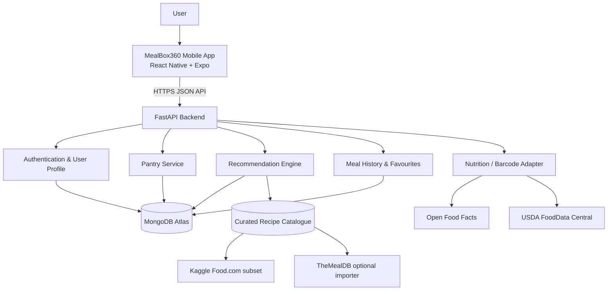

# MealBox360 — Updated Implementation Specification

**Purpose:** Upgrade the existing MealBox360 Expo + FastAPI prototype into a personalized pantry, meal-planning and recipe-recommendation application aligned with the requirements in the Gemini conversation.

**Document status:** Codex implementation brief, based on the supplied conversation and `README(4).md`, with external API/repository research checked on **1 November 2026**.

---

## 0. Instructions for the developer / Codex

Read this file together with the existing repository before changing code. The existing application is already running in Expo Go, so preserve that working baseline.

1. Inspect the actual repository tree, `frontend/package.json`, Expo app configuration, `frontend/App.tsx`, `backend/main.py`, backend requirements, and all existing API calls.
2. Do not assume the README describes every current file. Do not delete working code or replace the project with a new template.
3. Keep the current stack: **React Native + Expo + JavaScript/TypeScript frontend, Python + FastAPI backend**. Keep the current Expo SDK unless an installed dependency genuinely requires a compatible update.
4. Add features in small, testable steps. After each step run the backend tests, Expo/TypeScript checks available in the project, and verify the app still opens in Expo Go.
5. Use `npx expo install <package>` for Expo packages so versions match the installed SDK. Do not add native modules that require a custom development build unless clearly marked as a later optional feature.
6. Do not put MongoDB credentials, JWT secrets, USDA keys or other provider secrets in the mobile app. Only the API base URL may be an `EXPO_PUBLIC_*` variable.
7. Do not claim a feature is complete unless it works end-to-end in the mobile UI, FastAPI route, persistence layer and tests.
8. Update the root README after implementation with the actual features, environment setup, commands, API routes, data-source attribution and known limitations.

**Important scope decision:** This implementation covers the software-only project. Do not add IoT sensors, load cells, Arduino, Raspberry Pi or hardware integrations. Grocery ordering and live quick-commerce price comparison remain a later phase.

---

## 1. Product definition and scope

### 1.1 Product goal

MealBox360 helps people living independently — especially PG/hostel students and young office workers — decide what to cook using ingredients they already have. It should reduce meal-planning friction, encourage practical food choices, use ingredients before they expire, and reduce unnecessary grocery purchases.

It is a **lifestyle and cooking-assistance application**, not a medical application. It must not claim to diagnose, prevent, cure or treat any disease, and must not prescribe therapeutic diets.

### 1.2 Main user journey

1. User creates a profile and chooses food preferences, allergies and cooking constraints.
2. User adds available ingredients to a digital pantry, including optional quantity, unit, category and expiry date.
3. MealBox360 loads the user's pantry and recommends recipes from the local recipe catalogue.
4. The recommendation feed separates:
   - **Cook Now:** all required ingredients are available (ignoring only explicitly configured optional pantry staples).
   - **Almost There:** exactly one or two required ingredients are missing.
5. The user opens a recipe, reviews ingredients and cooking steps, and marks it as cooked.
6. The application records the meal in history and can offer to update pantry quantities. Do not silently deduct quantities when the recipe data does not contain reliable quantities.
7. The home screen highlights ingredients approaching their expiry date and recipes that can use them.

### 1.3 Included in this implementation

- Persistent database; no more in-memory-only pantry or recipes.
- User registration, login and per-user data separation.
- Profile and preference management.
- Full pantry create/read/update/delete (CRUD), search, categories and optional amounts.
- Optional expiry-date tracking and use-soon indicators.
- A normalized recipe catalogue seeded from curated data.
- Recipe detail screen with steps and ingredient availability.
- Improved recommendation engine with ingredient matching, filters, explanations and ranking.
- Cook Now and Almost There categories.
- Meal history, favourites/saved recipes and ratings/notes.
- Basic nutrition display only when trustworthy data is available.
- Optional barcode lookup for packaged food using Expo Camera + Open Food Facts.
- Optional local expiry reminders; keep push-notification requirements separate.
- Loading, empty, offline/network-error and API-error states.
- Backend tests and recommendation-engine tests.

### 1.4 Explicitly later / out of current scope

- Live prices or inventory from Zepto, Blinkit and Swiggy Instamart.
- Automated checkout, payment or grocery delivery.
- Medical/disease-specific diet plans.
- Image-based pantry recognition or receipt OCR requiring paid/cloud AI or a custom native build.
- IoT devices, sensors or hardware.
- Generative AI as a required dependency. The core recommender must work deterministically without an LLM or paid AI key.

---

## 2. What exists now and what must be upgraded

The supplied README describes the current Phase 1 prototype as:

- React Native + Expo mobile client (README says Expo SDK 58).
- FastAPI backend with CORS configured for local Wi-Fi testing.
- Add ingredient to pantry, duplicate prevention and case normalization.
- Basic content-based recipe matcher.
- Cook Now for a 100% match and Almost There for one or two missing items.
- Match percentage, missing-ingredient list and basic ranked recipe cards.
- In-memory data store; it is lost when the backend restarts.

The current README does **not** establish that authentication, a persistent database, a recipe dataset importer, nutrition integration, preferences, expiry dates, history, barcode scanning or production-grade error handling already exist. Treat these as new work unless inspection of the actual source code proves otherwise.

### Upgrade priority

| Priority | Upgrade | Reason |
|---|---|---|
| P0 | Database persistence and data models | Pantry, recipes and history must survive app/server restarts. |
| P0 | Dataset import and normalized ingredients | Recommendations need a real recipe catalogue, not only mock recipes. |
| P0 | Stronger recommendation/filter logic | This is the core academic and product value. |
| P0 | Meal history and recipe detail | Completes the user journey from suggestion to cooked meal. |
| P1 | Profile, food preferences and allergens | Makes recommendations personal and avoids unsuitable results. |
| P1 | Expiry tracking and use-soon ranking | Supports food-waste reduction. |
| P1 | Nutrition data integration | Adds transparent food information without medical claims. |
| P2 | Barcode lookup and local reminders | Useful convenience features; keep Expo Go compatibility. |
| Later | Grocery price comparison | Separate provider/partner integration phase. |

---

## 3. Recommended architecture



### 3.1 Responsibilities

**Mobile app (Expo):** screens, forms, pantry interactions, recipe cards, filters, local reminders and API client. It must not contain database credentials or external API secrets.

**FastAPI:** authentication, validation, business rules, pantry operations, recommendation calculation, recipe imports, nutrition lookups, user history and external-provider adapters.

**MongoDB Atlas:** users, preferences, pantry records, normalized ingredients, curated recipes, history, favourites and cached nutrition/product lookups.

**Data import scripts:** clean recipe CSV/JSON outside the mobile app and load a curated subset into MongoDB. Never download or parse a large dataset on the phone.

### 3.2 Database choice

Use **MongoDB Atlas Free** for the first cloud-backed prototype, consistent with the Gemini proposal and the dynamic nested recipe/pantry data. Use the official MongoDB Python driver with asynchronous access where supported; do not introduce a second database without a clear need.

Important free-tier limitation: the current Atlas Free cluster has a **0.5 GB storage limit**, limits throughput, and can automatically pause after 30 days with no connections. The Food.com dataset described below is about 0.89 GB in full, so it cannot be imported wholesale into this free cluster. Import a cleaned subset and keep source CSVs outside the database/repository. If the project grows beyond this, evaluate a paid Atlas tier or PostgreSQL/Supabase rather than trying to squeeze the full dataset into M0.

Create indexes for:

- `users.email` unique.
- `pantry_items.user_id`, `pantry_items.user_id + canonical_ingredient_id`, `pantry_items.expiry_date`.
- `recipes.external_source + external_id` unique where present.
- `recipes.normalized_ingredient_ids`, `recipes.category`, `recipes.total_time_minutes`.
- `meal_history.user_id + cooked_at`.
- `favourites.user_id + recipe_id` unique.

### 3.3 Suggested collections

**users**

```json
{
  "_id": "ObjectId",
  "email": "user@example.com",
  "password_hash": "hashed-password-only",
  "display_name": "Abdullah",
  "created_at": "ISO-8601 datetime",
  "is_active": true
}
```

**user_preferences**

```json
{
  "user_id": "ObjectId",
  "diet_type": "vegetarian | eggetarian | non_vegetarian | vegan | no_preference",
  "allergies": ["peanut"],
  "disliked_ingredients": ["mushroom"],
  "preferred_cuisines": ["Indian", "North Indian"],
  "max_cooking_minutes": 30,
  "budget_per_serving_inr": 100,
  "cooking_skill": "beginner | intermediate | confident",
  "servings_default": 1,
  "updated_at": "ISO-8601 datetime"
}
```

**ingredients** — canonical ingredient catalogue and aliases.

```json
{
  "_id": "ObjectId",
  "canonical_name": "capsicum",
  "normalized_key": "capsicum",
  "aliases": ["bell pepper", "green pepper"],
  "category": "vegetable",
  "is_common_pantry_staple": false
}
```

**pantry_items**

```json
{
  "_id": "ObjectId",
  "user_id": "ObjectId",
  "ingredient_id": "ObjectId",
  "display_name": "Rice",
  "quantity": 1.5,
  "unit": "kg",
  "category": "grains",
  "expiry_date": "2026-11-10",
  "added_at": "ISO-8601 datetime",
  "updated_at": "ISO-8601 datetime",
  "source": "manual | barcode | import",
  "notes": "optional"
}
```

Quantity, unit and expiry date are optional for the first version. If a recipe source has no ingredient quantity, the engine can only confirm ingredient presence, not whether the user has enough quantity.

**recipes**

```json
{
  "_id": "ObjectId",
  "external_source": "foodcom | themealdb | manual",
  "external_id": "source recipe id",
  "title": "Vegetable Pulao",
  "description": "optional short description",
  "ingredient_names": ["rice", "peas", "carrot"],
  "normalized_ingredient_ids": ["ObjectId"],
  "ingredients_detail": [
    {"name": "rice", "quantity": null, "unit": null, "required": true}
  ],
  "steps": ["Step 1", "Step 2"],
  "prep_minutes": null,
  "cook_minutes": null,
  "total_time_minutes": null,
  "servings": null,
  "difficulty": "easy | medium | hard | unknown",
  "cuisine": "Indian",
  "diet_tags": ["vegetarian"],
  "allergen_tags": [],
  "nutrition_per_serving": {
    "calories_kcal": null,
    "protein_g": null,
    "carbohydrates_g": null,
    "fat_g": null,
    "source": null,
    "is_estimate": true
  },
  "average_rating": null,
  "rating_count": 0,
  "image_url": null,
  "source_url": null,
  "attribution": "source name and URL",
  "quantity_aware": false,
  "created_at": "ISO-8601 datetime"
}
```

**meal_history**

```json
{
  "_id": "ObjectId",
  "user_id": "ObjectId",
  "recipe_id": "ObjectId",
  "recipe_title_snapshot": "Vegetable Pulao",
  "cooked_at": "ISO-8601 datetime",
  "servings": 1,
  "rating": 4,
  "notes": "optional",
  "ingredients_used": ["rice", "peas", "carrot"]
}
```

**favourites**

```json
{"user_id": "ObjectId", "recipe_id": "ObjectId", "saved_at": "ISO-8601 datetime"}
```

Keep a `source`/`attribution` field on imported recipes. Do not remove source credits.

---

## 4. Recipe data: datasets and ingestion plan

### 4.1 Primary academic dataset candidate: Food.com Recipes and Interactions

Kaggle source: <https://www.kaggle.com/datasets/shuyangli94/food-com-recipes-and-user-interactions>

The dataset contains approximately 180K+ recipes and 700K+ user reviews/interactions and is about 0.89 GB. Common files include:

- `RAW_recipes.csv` — recipe metadata, names, cooking time, tags, nutrition vector, number of steps, step text, description and ingredient names.
- `RAW_interactions.csv` — user ID, recipe ID, date, rating and review.

The recipe and interaction files have different row counts. Do **not** join them directly into one-to-many duplicate recipe rows. First group interactions by `recipe_id`, calculate average rating and rating count, and then join the aggregate to the recipe table.

**Important licensing caution:** Kaggle availability does not automatically mean the recipe text, images or source data can be freely redistributed. A recent dataset overview reports the Food.com interaction files as “Data files © Original Authors”. Check the actual Kaggle licence and original authors' terms before committing, republishing or shipping this data. For this academic prototype, keep the source files outside Git, cite the dataset, and use only the fields/quantity of data permitted by its terms. If redistribution rights are unclear, keep it as a local research input and use a dataset/API with explicit reuse rights for any public release.

### 4.2 Do not import the entire Food.com dump into Atlas Free

The full archive is approximately 0.89 GB, while an Atlas Free cluster stores up to 0.5 GB (including indexes). This is a hard mismatch.

Implement a configurable importer that:

1. Reads the raw CSV files from a local `backend/data/raw/` folder (that folder must be gitignored).
2. Uses `pandas` for CSV reading and `ast.literal_eval` only for serialized Python-list fields. Never use `eval` on dataset content.
3. Cleans malformed rows, empty ingredient lists, missing recipe IDs and recipes without usable steps.
4. Normalizes ingredient names with a reusable alias/canonicalization service.
5. Parses `minutes`, `n_steps`, `tags`, `ingredients`, `steps` and the nutrition array into structured fields.
6. Preserves the distinction between the calorie value and the other Food.com nutrition values, which are expressed as percentage of daily value (PDV) in the dataset description. Do not label PDV values as grams.
7. Aggregates interactions by recipe ID to compute `average_rating` and `rating_count` without duplicating recipe documents.
8. Adds `quantity_aware: false` when the recipe source gives ingredient names without usable quantities.
9. Applies configurable filters and exports a compact JSONL/CSV subset, starting with roughly 5,000–10,000 useful recipes; tune the count based on actual document size and Atlas storage remaining.
10. Imports using bulk writes and upserts keyed by `{external_source, external_id}` so rerunning the importer does not create duplicates.
11. Prints a summary: rows read, rows rejected, recipes imported, ingredient aliases unmatched, and estimated database footprint.

Do not commit the full Kaggle source files, raw user reviews or large images to the repository.

### 4.3 Recipe API fallback / enrichment: TheMealDB

Official API guide: <https://www.themealdb.com/docs_api_guide.php>

Development/test key: `1`.

Useful V1 endpoints include:

- Search meal by name: `https://www.themealdb.com/api/json/v1/1/search.php?s=Arrabiata`
- Full recipe detail: `https://www.themealdb.com/api/json/v1/1/lookup.php?i=52772`
- Filter by one ingredient: `https://www.themealdb.com/api/json/v1/1/filter.php?i=chicken_breast`
- List categories/areas/ingredients: `categories.php`, `list.php?c=list`, `list.php?a=list`, `list.php?i=list`
- Filter by area/cuisine: `filter.php?a=Indian`

The free V1 filter supports one ingredient. Multi-ingredient filtering is in the supporter/premium V2 API. For the free developer/test key, query individual pantry ingredients where useful, union candidate recipe IDs, fetch/cache full details, and perform MealBox360's own local multi-ingredient match. Do not design the core matching engine around a paid V2 endpoint.

TheMealDB says the test key is intended for development/personal use and recommends a supporter key for a public app-store release. Treat it as a prototype integration, not a guaranteed free production dependency. Cache results in MongoDB and always keep the local curated catalogue usable if the external service is unavailable.

### 4.4 Build a small India-relevant starter catalogue

Food.com and TheMealDB may not adequately represent the precise meals your target users cook in PGs. Include a small, reviewed Indian starter set (for example, poha, dal rice, vegetable pulao, egg bhurji, besan chilla, curd rice, simple paneer dishes, oats, and quick sandwiches) with accurate ingredients and steps. These can be manually entered with original text and source attribution where applicable. Clearly mark missing nutrition/time data as unknown instead of inventing it.

### 4.5 Data quality and recipe fields

- Store recipe times as integer minutes; keep prep and cooking times separate when available.
- Store nutrition per serving with source and `is_estimate` metadata.
- Do not infer nutrition grams from Food.com PDV fields.
- Missing recipe time is `null`, not `0`.
- Keep source URL and attribution so the user can open the original source where necessary.
- Preserve original ingredient text alongside the canonical ingredient ID for auditing.
- Keep unknown diet/allergen tags unknown; do not assume a recipe is allergen-free because a field is empty.

---

## 5. Free / low-cost API strategy

Use APIs for what they are good at; do not make every feature depend on a third-party API. The recommendation engine should use the local recipe database and continue to work offline from the external data providers.

| Source | Good use in MealBox360 | Free access / limitation | Recommendation |
|---|---|---|---|
| TheMealDB | Recipe search, categories, areas, recipe detail and images | Free test key `1` for development/personal use; free filter is single ingredient; multi-ingredient filter and public app-store use require supporter access | Use as optional recipe importer/enrichment, not the only recipe store. |
| Kaggle Food.com | Bulk recipe data and historical user ratings for the recommender | Large (~0.89 GB); licensing/reuse must be checked; do not treat as automatically open/publicly redistributable | Use a curated subset for research and import experiments, subject to licence. |
| USDA FoodData Central | Ingredient nutrient lookup and nutrition enrichment | Free API key; documented default limit 1,000 requests/hour/IP; data is public domain CC0 | Recommended optional nutrition source; call from backend and cache results. Food records are US-centric, so validate Indian ingredient matches. |
| Open Food Facts | Packaged food product lookup, barcode, ingredients, allergens and label nutrition | Free APIs; read operations do not require authentication; data is under open-data licensing including ODbL obligations; respect API usage rules and send an identifying User-Agent | Recommended for barcode/product lookup, not as the main recipe database. |
| Open Prices | Crowd-sourced observed product prices and store/location information | Public data/API; some write endpoints require an account/token; coverage depends on community contributions | Potential future research input; not a replacement for live Zepto/Blinkit catalogues. |
| Edamam | Recipe search, meal planning and nutrition | Official Meal Planner page advertises a limited free Developer tier (10 users, 20 meal-plan calls/user/day); Recipe Search paid plans start at a paid tier; web recipe content links back to its original source and does not provide full instructions | Optional only; do not make it a required dependency for the student build. |

### 5.1 USDA FoodData Central

Official docs: <https://fdc.nal.usda.gov/api-guide/>

- Obtain a free data.gov key and store it as `USDA_FDC_API_KEY` on the backend.
- Use `/foods/search` to find candidate foods and `/food/{fdcId}` for details.
- Cache responses by FDC ID/canonical ingredient to avoid repeat requests.
- Default published rate limit is 1,000 requests per hour per IP; `DEMO_KEY` is much lower and is only for trying sample requests.
- USDA data is CC0/public domain; attribute FoodData Central in the app's data sources screen/README as requested.
- Only calculate per-recipe nutrition when ingredient quantities, units and serving counts support a defensible calculation. Otherwise show source-provided nutrition or “Nutrition information unavailable”.

### 5.2 Open Food Facts and barcode flow

Official docs: <https://openfoodfacts.github.io/documentation/docs/>

Suggested flow:

1. Expo Camera scans a barcode.
2. Mobile sends barcode string to `POST /api/v1/products/barcode-lookup`.
3. Backend calls Open Food Facts product lookup and returns only normalized fields needed by the app.
4. User confirms product/ingredient name and quantity before adding it to the pantry.
5. Store barcode and source metadata, not a copy of the entire provider response.

Use the current Open Food Facts API documentation (v3 is the recommended current product API). Follow its User-Agent, rate and ODbL attribution/share-alike requirements. Open Food Facts contains packaged food products; it does not automatically provide recipe instructions or complete fresh-ingredient inventory.

### 5.3 Grocery pricing: plan honestly for Phase 4

I did not verify a documented, free, public consumer-price API for Zepto, Blinkit or Swiggy Instamart. Do not hard-code unofficial private endpoints, reverse-engineer internal app traffic or build the project around scraping that may violate provider terms or break frequently.

For the future comparison module, create a provider adapter interface now, but do not activate unverified providers:

```python
class GroceryPriceProvider:
    async def search_product(self, ingredient: str, postal_code: str) -> list[dict]:
        ...
```

Later sources to evaluate:

- Official partner/affiliate/catalogue feeds from each merchant, if access is granted.
- Open Prices community data for research/observed-price prototypes, with source/date/store clearly displayed.
- User-entered local prices or receipt entries for a transparent academic demo.
- Manual product links that redirect to the provider's official app/site, without claiming a live price.

Every future price result must include merchant, product/package size, price, location/pincode, observation timestamp, availability status and source. Do not compare ₹/kg with ₹/500 g without unit normalization. Mark stale prices as stale.

---

## 6. Recommendation engine — required behaviour

This is the main differentiating feature and should be a deterministic, testable Python service. It does not require a paid LLM.

### 6.1 Ingredient normalization

Create one normalization pipeline used by pantry input, recipe imports and barcode data:

- Trim whitespace, lowercase, normalize Unicode and punctuation.
- Map common synonyms to canonical ingredients (example: “bell pepper” → “capsicum”; “cilantro” → “coriander leaves” where context supports it).
- Normalize common plural forms and spelling variants.
- Keep the original display name for the UI.
- Use a curated alias table first. Fuzzy matching may suggest a correction, but must not silently merge ambiguous ingredients.
- Pantry staples such as salt, water and cooking oil may be configured as optional; show them as optional, not as silently available stock.

### 6.2 Filtering order

Apply hard exclusions before ranking:

1. Remove recipes that violate the user's explicit diet type.
2. Remove recipes that contain or may contain an explicitly listed allergen when the source data identifies it. If allergen data is unknown, show “Allergen information not verified”; do not guarantee safety.
3. Remove recipes using explicitly disliked ingredients when the user has enabled that preference.
4. Apply maximum cooking time and cuisine preferences as filters or soft preferences according to the UI selection.

### 6.3 Availability categories

For each recipe, compare required canonical recipe ingredients to the user's pantry:

- **Cook Now:** zero missing required ingredients.
- **Almost There:** one or two missing required ingredients.
- **Not a current recommendation:** more than two missing required ingredients. It may optionally appear in a separate discovery/search area, but must not dilute the main recommendation feed.

Only ignore ingredients flagged as optional in the recipe or as pantry staples in the user's settings. The UI must explain which ingredients are missing.

If recipe quantities are missing (`quantity_aware=false`), use presence-only matching and label the limitation internally/API-side. Do not claim the stored quantity is sufficient.

### 6.4 Ranking within each category

After hard filters and category assignment, rank recipes using explainable signals. Start with a configurable weighted score, for example:

- 40% pantry coverage (higher is better; use normalized presence/quantity data available).
- 20% use-soon bonus (recipe uses ingredients that expire soon).
- 15% cooking-time fit (prefer recipes within the user's limit).
- 15% user preference fit (cuisine, vegetarian/egg preferences, skill level and favourites).
- 10% nutrition/balance signals (only where data is available; otherwise omit and renormalize weights).

Keep the weights in backend configuration, not scattered through route code. Include `score_breakdown` or `recommendation_reasons` in the API response so the app can say things such as:

- “Uses all 6 ingredients in your pantry.”
- “Uses spinach that may expire soon.”
- “Ready in about 20 minutes.”
- “Matches your vegetarian preference.”
- “Needs only onion and curd.”

Do not show fabricated calories, costs, preparation times or nutrition scores.

### 6.5 Health/lifestyle positioning

Use neutral descriptions such as “balanced-meal indicators”, “vegetable source”, “protein source”, “whole-grain option” and “quick homemade option”. Avoid a definitive medical “healthy/unhealthy” score unless a validated, clearly explained scoring standard is implemented. Do not suggest a recipe treats a condition or is medically appropriate for a disease.

Add a visible app disclaimer in onboarding/profile and in the About/Data Sources screen:

> MealBox360 provides general meal-planning and food-choice assistance for lifestyle convenience. It is not medical advice and is not intended to diagnose, treat, cure or prevent any disease. Nutrition and allergen data may be incomplete or estimated; always verify product labels and consult a qualified professional for medical dietary needs.

---

## 7. Mobile application screens and features

Keep the app visually consistent and mobile-first. Do not make it a plain admin dashboard. Build a clean food/meal discovery experience with readable cards, clear status, accessible controls and useful empty states.

### 7.1 Home dashboard

- Greeting and today's meal prompt.
- Pantry item count.
- Expiring soon summary.
- “Cook Now” preview cards.
- “Almost There” preview cards.
- Quick actions: Add ingredient, Scan barcode, Discover recipes.
- Small weekly meal/history summary once history exists.

### 7.2 Pantry screen

- Ingredient search/autocomplete.
- Add ingredient with name, quantity, unit, category and optional expiry date.
- Edit and delete pantry item.
- Search/filter by category.
- Visual states: Fresh, Use Soon, Expired (based on dates, with neutral language).
- Prevent duplicate canonical ingredients; editing an existing item should not create another duplicate.
- Support quantity updates; validate quantity is positive and unit is allowed.
- Allow users to enter items even when the ingredient catalogue has no exact match, but keep the record flagged for review/alias mapping.

### 7.3 Discover / recommendations screen

- Tabs or segmented control: Cook Now / Almost There.
- Filters: max time, cuisine, dietary preference, difficulty and serving count.
- Recipe cards: image if available, title, estimated time, cuisine, match percentage, missing item count and 1–2 recommendation reasons.
- Clearly state “Needs 2 ingredients” for Almost There.
- No results state: explain how to add more pantry items or relax filters.

### 7.4 Recipe detail screen

- Recipe title, source and image (if licensed/available).
- Cooking/prep time only when known.
- Ingredient checklist with Available / Missing / Optional states.
- Cooking steps with readable numbered instructions.
- Nutrition panel only if reliable data exists, showing source and whether values are estimated.
- Save/favourite.
- “Mark as cooked” action.
- On mark-cooked, record history. Ask before deducting pantry amounts. Deduct only when quantity data is adequate; otherwise record the meal and show a note that stock was not automatically deducted.

### 7.5 Meal history

- Chronological list grouped by day/week.
- Recipe title, cooked date and servings.
- Optional rating and notes.
- Reopen recipe if still available.
- Basic stats: number of home-cooked meals, most cooked recipes and ingredients used from pantry. Avoid exaggerated claims of food waste prevented unless measurable data exists.

### 7.6 Profile and preferences

- Diet type (no preference, vegetarian, eggetarian, non-vegetarian, vegan).
- Allergies, disliked ingredients and preferred cuisines.
- Maximum cooking time, default servings and optional budget target.
- Cooking skill/equipment preferences (simple burner, microwave, induction, oven) if practical.
- Data sources, privacy and non-medical disclaimer.

### 7.7 Barcode scanner (optional P2)

Use `expo-camera` and barcode scanning, which are included in the current Expo Go documentation for SDK 58. Keep the API call on the backend. The user must confirm the scanned product details before pantry insertion.

### 7.8 Expiry reminders (optional P2)

Use local notifications for expiry reminders. Local notifications can work in Expo Go; remote push notifications on Android require a development build in current Expo SDK guidance. Do not promise push notification delivery in Expo Go. Add a reminder schedule such as 3 days and 1 day before expiry, with permission handling and user controls.

---

## 8. Backend API contract

Use a versioned prefix: `/api/v1`. Validate all inputs with Pydantic models. Return consistent error objects. Protect user-owned resources so one user cannot access another user's pantry/history.

### 8.1 System and authentication

| Method | Route | Purpose |
|---|---|---|
| GET | `/health` | Health check and database connectivity status (do not expose secrets). |
| POST | `/api/v1/auth/register` | Create user and preferences defaults. |
| POST | `/api/v1/auth/login` | Return access token. |
| GET | `/api/v1/auth/me` | Current user profile. |
| PUT | `/api/v1/profile` | Update display name/profile. |
| GET | `/api/v1/preferences` | Get user preferences. |
| PUT | `/api/v1/preferences` | Update diet, allergies, cuisine, time and servings. |

Use hashed passwords (Argon2 recommended), signed JWT access tokens with expiry, and authenticated routes. Never store plaintext passwords. For local development, seed one demo user instead of bypassing authentication across the entire codebase.

### 8.2 Ingredient and pantry

| Method | Route | Purpose |
|---|---|---|
| GET | `/api/v1/ingredients/search?q=rice` | Ingredient autocomplete/canonical lookup. |
| GET | `/api/v1/pantry` | Current user's pantry. |
| POST | `/api/v1/pantry` | Add pantry ingredient. |
| PATCH | `/api/v1/pantry/{item_id}` | Edit quantity, unit, expiry or category. |
| DELETE | `/api/v1/pantry/{item_id}` | Remove pantry item. |
| GET | `/api/v1/pantry/expiring?within_days=3` | Items approaching expiry. |

### 8.3 Recipes and recommendation engine

| Method | Route | Purpose |
|---|---|---|
| GET | `/api/v1/recipes/recommendations?mode=cook_now` | Cook Now recommendations. |
| GET | `/api/v1/recipes/recommendations?mode=almost_there` | Recipes missing 1–2 ingredients. |
| GET | `/api/v1/recipes/{recipe_id}` | Recipe details and current pantry match. |
| GET | `/api/v1/recipes/search?q=poha` | Search local recipe catalogue. |
| GET | `/api/v1/recipes/categories` | Cuisine/category filters. |
| POST | `/api/v1/recipes/{recipe_id}/favourite` | Save recipe. |
| DELETE | `/api/v1/recipes/{recipe_id}/favourite` | Remove saved recipe. |
| GET | `/api/v1/recipes/favourites` | User's saved recipes. |

Recommendation response should include:

```json
{
  "mode": "almost_there",
  "items": [
    {
      "recipe_id": "...",
      "title": "Vegetable Pulao",
      "match_percent": 80,
      "matched_count": 4,
      "required_count": 5,
      "missing_ingredients": ["peas"],
      "total_time_minutes": 25,
      "recommendation_reasons": ["Uses 4 ingredients in your pantry", "Ready in about 25 minutes"],
      "nutrition": null,
      "source_url": "..."
    }
  ],
  "total": 1
}
```

Do not send fake nutrition values. Use `null` where data is unavailable.

### 8.4 Meal history

| Method | Route | Purpose |
|---|---|---|
| POST | `/api/v1/meals/history` | Mark recipe cooked and create history record. |
| GET | `/api/v1/meals/history` | Paginated current-user history. |
| GET | `/api/v1/meals/history/summary` | Weekly/monthly meal summary. |
| PATCH | `/api/v1/meals/history/{entry_id}` | Update rating or notes. |
| DELETE | `/api/v1/meals/history/{entry_id}` | Remove history entry. |

### 8.5 External data adapters

| Method | Route | Purpose |
|---|---|---|
| POST | `/api/v1/products/barcode-lookup` | Backend lookup via Open Food Facts (optional P2). |
| GET | `/api/v1/nutrition/ingredient?q=spinach` | Cached USDA ingredient nutrient search (optional P1). |
| POST | `/api/v1/admin/import/recipes` | Protected/admin-only trigger if needed; prefer CLI import script for local work. |

Keep TheMealDB, USDA and Open Food Facts code in separate service/adapters. External API failure must not break pantry CRUD or recommendations from the local database.

---

## 9. Suggested repository structure

Adapt this to the real existing tree. Do not rename folders solely to match this example if that would break Expo scripts or imports.

```text
MealBox360/
├── README.md
├── IMPLEMENTATION_PLAN.md
├── .gitignore
├── backend/
│   ├── main.py
│   ├── requirements.txt
│   ├── .env.example
│   ├── app/
│   │   ├── core/              # settings, JWT/password security
│   │   ├── db/                # MongoDB client, indexes
│   │   ├── models/            # persistence/domain models
│   │   ├── schemas/           # Pydantic request/response models
│   │   ├── api/v1/            # auth, profile, pantry, recipes, history
│   │   ├── services/          # matching, normalization, nutrition, providers
│   │   └── utils/
│   ├── scripts/
│   │   ├── import_foodcom.py
│   │   ├── import_themealdb.py
│   │   └── seed_demo_data.py
│   ├── data/
│   │   ├── raw/               # gitignored source downloads
│   │   └── processed/         # gitignored generated datasets unless licence permits
│   └── tests/
│       ├── test_auth.py
│       ├── test_pantry.py
│       ├── test_recommendations.py
│       ├── test_history.py
│       └── test_importer.py
└── frontend/
    ├── App.tsx
    ├── app.json
    ├── .env.example
    └── src/
        ├── api/               # typed API client and auth token handling
        ├── components/        # cards, badges, forms, empty/error states
        ├── screens/           # Home, Pantry, Discover, RecipeDetail, History, Profile
        ├── navigation/
        ├── hooks/
        ├── context/            # auth/user state if needed
        ├── types/
        └── utils/
```

Suggested backend Python libraries (confirm compatibility before pinning): FastAPI, Uvicorn, Pydantic Settings, PyMongo async driver, password hashing/JWT library, pandas for one-off dataset import, pytest and HTTPX for tests. Keep pandas out of the mobile app and preferably out of the runtime dependency path if only used by import scripts.

Suggested Expo packages only when needed and only in Expo Go-compatible versions: `expo-camera`, `expo-notifications` (local notifications), `expo-sqlite` (optional local cache), and `expo-secure-store` (token storage). Use `npx expo install` rather than hand-picking versions.

---

## 10. Environment variables and local networking

### backend/.env.example

```dotenv
APP_ENV=development
JWT_SECRET_KEY=replace-with-a-long-random-secret
JWT_ACCESS_TOKEN_EXPIRE_MINUTES=60
MONGODB_URI=mongodb+srv://<username>:<password>@<cluster-url>/<database>
MONGODB_DATABASE=mealbox360
CORS_ORIGINS=http://localhost:8081,http://127.0.0.1:8081
THEMEALDB_API_KEY=1
USDA_FDC_API_KEY=
OPENFOODFACTS_USER_AGENT=MealBox360/1.0 (student project contact: your-email@example.com)
```

### frontend/.env.example

```dotenv
EXPO_PUBLIC_API_URL=http://192.168.1.10:8001
```

- For a physical phone using Expo Go, use the laptop's LAN IP address, not `localhost`.
- Both devices must be on the same Wi-Fi and the backend must bind to `0.0.0.0`.
- For Android emulator, `http://10.0.2.2:8001` may be used.
- Do not commit `.env` files. Add local data downloads, `.venv`, `node_modules`, build folders and secrets to `.gitignore`.
- Restrict CORS to the real development origins and configure production origins explicitly.

---

## 11. Implementation stages and acceptance criteria

### Stage 0 — Audit and preserve working app

- Run the current app and backend before changing them.
- Record the existing endpoint contracts and current Expo SDK/dependency versions.
- Add a baseline screenshot or smoke-test notes.
- Confirm the app can still be opened through Expo Go.

**Done when:** the unmodified baseline works and there is a safe Git checkpoint.

### Stage 1 — MongoDB persistence and authentication (P0)

- Add configuration through environment variables.
- Connect FastAPI to MongoDB and create indexes.
- Replace in-memory pantry state with user-scoped database operations.
- Add registration/login/current-user endpoints and password hashing/JWT.
- Add clear error handling for unavailable database and invalid credentials.

**Done when:** pantry items remain after backend restart; users cannot read or change another user's data; secrets are not committed.

### Stage 2 — Recipe dataset and canonical ingredient catalogue (P0)

- Add importer and a small seed dataset first.
- Add the Food.com CSV preprocessing path with licence warning and subset controls.
- Aggregate ratings by recipe ID before import.
- Add curated Indian starter recipes for the demo.
- Create ingredient canonicalization and alias tests.

**Done when:** recipes load from MongoDB, importer can be rerun without duplicates, and imported data retains source attribution.

### Stage 3 — Recommendation engine v2 (P0)

- Implement exact Cook Now/Almost There classification.
- Add alias normalization, optional pantry staples, preferences and allergy exclusions.
- Add time/difficulty/cuisine filters.
- Add expiry-ingredient boost and score explanations.
- Add deterministic automated tests with fixtures.

**Done when:** a fixture with all items returns Cook Now; a recipe missing 1 or 2 required items returns Almost There; 3+ missing does not appear in the main recommendation feed; allergens/diet exclusions work.

### Stage 4 — Mobile experience and API integration (P0)

- Introduce navigation without breaking the existing entry point.
- Build Home, Pantry, Discover, Recipe Detail and Profile screens.
- Connect forms and cards to the real API.
- Add loading, empty, validation, retry and network-error states.
- Test a real phone on the same Wi-Fi.

**Done when:** a user can add an ingredient, see updated recommendations and open recipe details on Expo Go.

### Stage 5 — Meal history, favourites and expiry (P1)

- Add mark-cooked flow and meal-history persistence.
- Add saved recipes and history screens.
- Add expiry indicators and expiring-items endpoint.
- Add optional local notification reminders.

**Done when:** a cooked meal appears in history after app/backend restart; favourite state persists; expiry states are correct for test dates.

### Stage 6 — Nutrition and barcode enrichment (P1/P2)

- Add backend USDA lookup/cache and source-aware nutrition values.
- Add Open Food Facts barcode lookup.
- Add Expo Camera barcode flow only after confirming current Expo Go compatibility.
- Do not display estimates as exact values; do not allow provider failure to block core app behaviour.

**Done when:** a scanned barcode can be reviewed by the user and added to pantry; nutrition fields retain source and estimate metadata.

### Stage 7 — QA, documentation and demonstration

- Run automated tests and manual Android Expo Go tests.
- Verify invalid data, no network, empty pantry, unknown ingredient, missing nutrition and external API outage.
- Update README with actual run commands and screenshots.
- Prepare a clear architecture/block diagram and explain the dataset, recommendation model and limitations.

**Done when:** all P0 acceptance checks pass and the README accurately matches the delivered code.

### Rough effort estimate

For one developer working consistently with Codex assistance, a practical estimate for the P0 build is approximately **7–12 focused working days** after the existing project runs locally. Adding expiry, history, nutrition lookup, barcode and reminder polish may take another **4–7 working days**. Actual time depends on the condition of the source code, MongoDB setup, dataset cleaning and device/network debugging. This is an engineering estimate, not a promise that generated code will work without testing.

---

## 12. Testing requirements

### Recommendation unit tests

Create fixtures for at least these cases:

1. Pantry contains every required ingredient → Cook Now, 100% match.
2. Pantry misses one ingredient → Almost There, one missing item.
3. Pantry misses two ingredients → Almost There, two missing items.
4. Pantry misses three ingredients → excluded from main recommendation lists.
5. Ingredient alias resolves correctly (e.g. “bell pepper”/“capsicum”).
6. Optional pantry staple does not incorrectly block Cook Now.
7. Allergy match excludes a recipe when the source explicitly marks the allergen.
8. Unknown allergen data produces an uncertainty indicator, not an “allergen-free” claim.
9. Expiring pantry ingredient increases the recipe's use-soon ranking.
10. Unknown recipe time/nutrition remains null and is never displayed as zero or fabricated.
11. Food.com interactions aggregate to one recipe row per recipe ID.
12. A recipe with `quantity_aware=false` does not trigger automatic quantity deduction.

### API integration tests

- Register/login, expired/invalid token, authenticated profile.
- Pantry add/edit/delete and duplicate canonical ingredient behaviour.
- Per-user access isolation.
- Recipe detail and recommendations with empty/non-empty pantry.
- Meal history create/list/edit/delete.
- MongoDB unavailable error handling.
- External API timeout/429 handling and cache hit behaviour.

### Expo Go manual checks

- Android physical device on LAN.
- Keyboard does not hide important add-item controls.
- Back navigation and bottom navigation are consistent.
- Loading, empty, success and error states are visible.
- Long ingredient names and recipe instructions wrap correctly.
- No key or database URI appears in the mobile bundle or logs.

---

## 13. GitHub repositories and reusable references

These are references to inspect, not instructions to copy an entire project. Before reusing code, inspect its current `LICENSE`, dependency licences, attribution requirements and native-module requirements. If a repository has no clear licence, do not copy its source into MealBox360; use it only to understand patterns.

1. **PantryPilot — <https://github.com/codexblack/PantryPilot>**
   - Closest architecture match: Expo/React Native mobile app + FastAPI backend.
   - Useful ideas: pantry capture flow, ingredient correction, recipe result schema, saved recipes, API timeout/error handling and modular backend services.
   - It relies on OpenAI API and SerpAPI/Google Shopping/Places integrations for some features; these are not a free-only implementation. Treat it as architecture/UI inspiration and do not assume it can run free without provider keys.
   - Check its repository licence before copying any code.

2. **Recipedia — <https://github.com/AntoC-dev/Recipedia>**
   - Expo/React Native recipe-management app with SQLite, fuzzy search, shopping-list and OCR ideas.
   - Useful for recipe cards, local search, offline data layout and screen/component organization.
   - It is local-first and has no backend, so it does not replace the FastAPI/MongoDB architecture. Verify OCR/native dependencies before attempting to use them in Expo Go.

3. **PantryAI — <https://github.com/fatibelkoudia/pantryai>**
   - Useful reference for pantry/expiry flows, barcode and receipt ingestion, recipe suggestions and separation of mobile/shared/backend packages.
   - Its stack differs: Expo SDK 55 mobile with NestJS/PostgreSQL/Supabase services, plus external OCR integrations. Do not transplant its backend into this Python/FastAPI project.

4. **Official Expo examples and SDK documentation**
   - Camera example: <https://docs.expo.dev/versions/v58.0.0/sdk/camera/> — barcode scanning and camera APIs; documented as included in Expo Go.
   - SQLite: <https://docs.expo.dev/versions/latest/sdk/sqlite/> — persistent local cache/database if offline-first behaviour is later needed; documented as included in Expo Go.
   - Notifications: <https://docs.expo.dev/versions/latest/sdk/notifications/> — local notification support; Android remote push needs a development build in the current SDK guidance.

**Best reuse decision:** keep MealBox360's existing project and adopt only selected patterns. PantryPilot is the closest architecture reference; Recipedia is a UI/local-search reference; Expo's own SDK docs should determine whether a package is actually safe for the current Expo Go environment.

---

## 14. Academic explanation: data and model used

Use the following technically accurate explanation in project reviews:

- **Data:** curated recipe records from a permitted Food.com Kaggle subset and/or TheMealDB; normalized ingredient catalogue; user pantry records, profile preferences and meal history; optional nutrient values from USDA FoodData Central and packaged-product information from Open Food Facts.
- **Model:** an explainable, content-based recommendation model. It compares the normalized ingredient set of each recipe with the user's current pantry, categorizes full matches and near matches, applies preference/allergen/time filters, and ranks candidates using pantry coverage, expiry urgency, time and preference signals.
- **Personalization:** user-specified food preferences, allergies, disliked ingredients, cuisine and time constraints; future use of favourites and meal history to adjust ranking.
- **Evaluation:** precision of Cook Now/Almost There categorization on a manually verified test set, percentage of returned recipes feasible with current pantry, number of missing ingredients, response latency, and user feedback after cooking.
- **Limitations:** dataset quality and licence restrictions; ingredient aliases and inconsistent measurements; incomplete nutrition/allergen data; presence-only matching where source quantities are absent; changing external API availability.

Do not describe the recommender as a trained deep-learning model unless one is actually trained and evaluated. The initial model is an explainable content-based/filtering and weighted-ranking algorithm. This is a valid and defensible model choice for the current project.

---

## 15. Final Codex task prompt

After placing this file at the project root, open the existing MealBox360 folder in Codex and use this prompt:

> Read `README.md`, `MealBox360_CODEX_Implementation_Plan.md` (or the exact name of this plan file), and inspect the complete existing repository. The project currently uses a React Native + Expo Go frontend and a Python FastAPI backend. I want you to upgrade the existing working project according to the implementation plan, not create a separate replacement project.
>
> First report the actual current folder structure, implemented features, missing features, Expo SDK/dependency versions, current API contract and any risks. Then propose a short ordered implementation checklist. Start with Stage 0 and Stage 1: preserve the existing working Expo screen, add MongoDB persistence and secure user authentication, and update the README/environment examples. Do not yet implement the grocery comparison phase, IoT/hardware, paid AI providers or unofficial grocery scraping.
>
> Work in small steps. Before changing a file, explain the intended change briefly. Preserve existing behaviour unless the plan explicitly changes it. Use Expo-compatible dependency versions via `npx expo install`. Keep all secrets in backend environment variables. Add tests for every backend feature and recommendation rule. After each stage, run the available tests/type checks and tell me exactly which commands passed, which failed, and what I must configure manually. Do not claim completion when a service has not been configured or a feature has not been tested on Expo Go.
>
> When Stage 1 is verified, continue through the P0 stages in the order specified in the plan. Do not silently skip dataset licence checks, API limits, missing nutrition data or quantity-matching limitations. Update the root README to describe only what is genuinely implemented.

---

## 16. Research references

The following official/primary references were consulted for API features and platform compatibility. Verify terms again before public distribution, because provider terms and free-tier limits can change.

- TheMealDB API Guide: <https://www.themealdb.com/docs_api_guide.php>
- TheMealDB API access and test key: <https://www.themealdb.com/api.php>
- Food.com dataset description and file columns: <https://practicaldsc.org/final-project/datasets/recipes-and-ratings/>
- Food.com Recipes and Interactions research record: <https://berd-platform.de/records/dmajj-zp851>
- Kaggle Food.com Recipes and User Interactions: <https://www.kaggle.com/datasets/shuyangli94/food-com-recipes-and-user-interactions>
- Dataset licence caveat / API comparison (secondary source): <https://www.tinyplates.dev/blog/free-recipe-datasets>
- USDA FoodData Central API and limits/licensing: <https://fdc.nal.usda.gov/api-guide/>
- Open Food Facts API documentation: <https://openfoodfacts.github.io/documentation/docs/>
- Open Prices project and API: <https://openfoodfacts.github.io/open-prices/> and <https://github.com/openfoodfacts/open-prices>
- MongoDB Atlas Free cluster limits: <https://www.mongodb.com/docs/atlas/reference/free-shared-limitations/>
- Edamam Recipe Search API plans and content restrictions: <https://developer.edamam.com/edamam-recipe-api>
- Edamam Meal Planner Developer plan: <https://developer.edamam.com/meal-planner-api>
- Expo Camera SDK 58: <https://docs.expo.dev/versions/v58.0.0/sdk/camera/>
- Expo SQLite: <https://docs.expo.dev/versions/latest/sdk/sqlite/>
- Expo Notifications: <https://docs.expo.dev/versions/latest/sdk/notifications/>
- PantryPilot: <https://github.com/codexblack/PantryPilot>
- Recipedia: <https://github.com/AntoC-dev/Recipedia>
- PantryAI: <https://github.com/fatibelkoudia/pantryai>

---

**End of implementation specification.**
