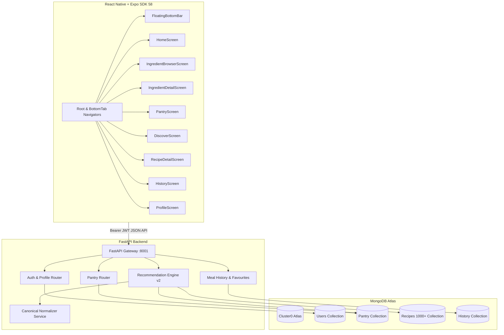

# MealBox360 🥫🍳

> **Personalized Pantry Management & Smart Recipe Recommendation System**  
> *Full-Stack Implementation (Expo SDK 58 + React Native + FastAPI + MongoDB Atlas)*

MealBox360 helps users eliminate food waste and simplify meal planning by tracking available ingredients in a digital pantry and providing smart, instant recipe recommendations based on what is already available at home.

---

## 📌 Features Implemented

### 📱 1. Modern Mobile UI & Design System (Expo SDK 58 + React Native)
* **Visual Identity & Tokens**: Inspired by modern grocery & pantry companion design standards with deep forest-teal headers (`#003B36`), high-energy lime-green interaction accents (`#B9ED62`), clean white cards, and warm cream subtitles (`#FEFFE5`).
* **Curved Forest Header**: Signature curved bottom arcs (`CurvedHeaderBackground` & `AppHeader`) featuring safe-area handling, back navigation, search slots, and a real-time pantry count badge.
* **White Pill Search Bar**: Rounded search field with leading `🔍` icon, live text filtering, and an instant clear button (`✕`).
* **Circular Pastel Category Shortcuts**: Quick-filter circular pastel tiles with food icons (🥦 Vegetables, 🍎 Fruits, 🌾 Grains, 🧀 Dairy, 🥚 Protein, 🌶️ Spices).
* **Interactive Quantity Steppers**: Compact plus button (`+`) when count is 0; expands smoothly into a lime green `[-] [qty] [+]` pill when stocked in the pantry.
* **Floating Capsule Bottom Navigation**: Elevated pill-shaped tab bar (`FloatingBottomBar`) floating gracefully above the safe area with lime active tab pills.
* **Core Screens**:
  - 🏠 **Home Dashboard (`HomeScreen.tsx`)**: Curved forest header, search shortcut, category shortcuts rail, lifestyle anti-waste tip banner, "You might need" horizontal ingredient rail with live steppers, and "Cook Now" / "Almost There" recipe recommendation rails.
  - 🥦 **Daily Foods / Ingredient Browser (`IngredientBrowserScreen.tsx`)**: 2-column image-led ingredient cards with live steppers, horizontal category tabs (`All`, `Vegetables`, `Fruits`, etc.), and real-time search.
  - 🔍 **Ingredient Details (`IngredientDetailScreen.tsx`)**: Large hero food image, pantry stock status banner, storage and freshness tips, "Recipes with this ingredient" rail, and sticky bottom bar with quantity stepper and `+ Add to Pantry` / `✓ Update Pantry` actions.
  - 🥫 **Digital Pantry (`PantryScreen.tsx`)**: Search, category filters, item cards with quantity badges and steppers, quick delete confirmation, and restyled "Add Custom Ingredient" modal.
  - 🍳 **Discover Screen (`DiscoverScreen.tsx`)**: Segmented controls (*"Ready to Cook"* vs *"Almost There"*), preparation time limit chips (≤ 15m, ≤ 30m, ≤ 45m), and rich match cards.
  - 📖 **Recipe Detail (`RecipeDetailScreen.tsx`)**: Large recipe hero photography, favourite toggle (`❤️`/`🤍`), ingredient checklist with pantry availability badges, numbered steps, and a sticky lime green *"Mark as Cooked"* action.
  - 📅 **Meal History (`HistoryScreen.tsx`)**: Cooking milestones summary card (total meals cooked & favourites count), chronological meal log, and interactive star ratings.
  - 👤 **Profile & Preferences (`ProfileScreen.tsx`)**: Avatar badge, dietary preferences tags (Vegetarian, Vegan, Keto, Halal, etc.), cooking skill selector, and non-medical disclaimer.
  - 🔐 **Auth Screens (`LoginScreen.tsx` & `RegisterScreen.tsx`)**: Forest-curved headers, rounded credential cards, pre-filled demo account hint, and lime submit buttons.

---

### 🥫 2. Digital Pantry Management
- **Full CRUD operations**: Add, update, view, and delete pantry items.
- **Quantity & Unit support**: Quantities and units (e.g., `500 g`, `1 cup`, `3 pcs`).
- **Expiry Date Tracking**: Highlights ingredients approaching expiry (`Expiring Soon` within 7 days, `Fresh`, or `Expired`).
- **Canonical Alias Normalization**: Maps synonyms and Indian ingredient names (e.g., `bell pepper` → `capsicum`, `cilantro` / `dhania` → `coriander leaves`, `pyaz` → `onion`).
- **Duplicate Prevention**: Rejects duplicate canonical ingredients for the same user.

---

### 🍳 3. Explainable Content-Based Recommendation Engine v2
- **Cook Now (100% Match)**: Identifies recipes where every required ingredient is present in the pantry (ignoring optional pantry staples like salt, water, cooking oil).
- **Almost There (Missing 1–2 items)**: Surfaces recipes where the user only needs 1 or 2 ingredients.
- **Weighted Scoring & Ranking**:
  - 40% Pantry Coverage
  - 20% Expiry Urgency Bonus (promotes recipes that use ingredients expiring soon)
  - 15% Cooking Time Fit
  - 15% Dietary / Preference Match
  - 10% Nutrition Signals (when available)
- **Human-Readable Reasons**: Each card explains why it was recommended (e.g., *"Uses all 4 ingredients in your pantry"*, *"Uses spinach that may expire soon"*, *"Ready in about 20 minutes"*).
- **Hard Exclusions**: Filters by dietary preferences (`vegetarian`, `eggetarian`, `vegan`) and explicitly excludes recipes with user's allergens or disliked ingredients.

---

### 🔐 4. Authentication & Multi-User Support
- **Secure Password Hashing**: Encrypted using modern `bcrypt`.
- **JWT Authorization**: Signed Bearer tokens with configurable expiration.
- **Per-User Isolation**: Each user has private pantry, history, preferences, and favourites.
- **Pre-Seeded Demo Account**: Ready for instant sign-in.

---

### 📖 5. Curated Recipe Catalogue & Food.com Dataset
- **Indian Starter Recipes**: 16 carefully curated homestyle recipes (Poha, Dal Rice, Vegetable Pulao, Egg Bhurji, Besan Chilla, Curd Rice, Paneer Bhurji, Oats Upma, etc.).
- **Food.com Kaggle Ingestion**: Importer cleans, filters, aggregates ratings from 1.13M user interactions, and imports curated subsets into MongoDB Atlas.
- **Over 1,000+ Recipes** currently indexed and searchable in the Atlas cluster.

---

### 📅 6. Meal History & Home Cooking Milestones
- **"Mark as Cooked" flow**: Records home-cooked meals in chronological history.
- **Safe Quantity Handling**: Transparently flags presence-only recipes (`quantity_aware: false`) so stock is not incorrectly deducted without accurate measurements.
- **Ratings & Notes**: Users can rate (1–5 stars) their cooked meals.
- **Cooking Summary**: Tracks total homemade meals prepared and most frequently cooked recipes.

---

## 🏗️ Architecture & Component Overview



---

## 🚀 How to Run the Project

### Prerequisites
- **Node.js** (v18+) & **npm**
- **Python** (v3.10+)
- **Expo Go** app on your physical mobile device (or Android/iOS emulator)

---

### Step 1: Start Backend (FastAPI)

1. Open a terminal in `backend/`:
   ```bash
   cd backend
   source .venv/bin/activate
   ```
2. Verify environment configuration in `backend/.env`:
   ```dotenv
   APP_ENV=development
   JWT_SECRET_KEY=mealbox360-super-secret-jwt-key-change-in-production-abcdef123456
   MONGODB_URI=mongodb+srv://<user>:<password>@cluster0.uxhe1tn.mongodb.net
   MONGODB_DATABASE=mealbox360
   ```
3. (Optional) Run the test suite:
   ```bash
   pytest tests/ -v
   ```
4. Start the server (binding to `0.0.0.0` for local Wi-Fi mobile testing):
   ```bash
   uvicorn main:app --host 0.0.0.0 --port 8001 --reload
   ```
5. Check health status in your browser:
   - Health: [http://localhost:8001/health](http://localhost:8001/health)
   - Interactive Docs: [http://localhost:8001/docs](http://localhost:8001/docs)

---

### Step 2: Seed Data (Already executed on Atlas cluster)

To re-seed or update demo data:
```bash
# Seed 16 Indian starter recipes, canonical ingredients & demo user:
python scripts/seed_demo_data.py

# Import Food.com Kaggle dataset subset (if RAW_recipes.csv is in data/raw/):
python scripts/import_foodcom.py --limit 1000
```

**Seeded Demo Account Credentials:**
- **Email:** `demo@mealbox360.com` *(or `demo@mealbox360.local`)*
- **Password:** `demo1234`

---

### Step 3: Start Mobile App (Expo Go)

1. Open a terminal in `frontend/`:
   ```bash
   cd frontend
   ```
2. Set your machine's local Wi-Fi IP in `frontend/.env` so your physical device can reach the backend:
   ```dotenv
   EXPO_PUBLIC_API_URL=http://<YOUR_LAN_IP>:8001
   # Example: EXPO_PUBLIC_API_URL=http://192.168.1.39:8001
   ```
3. Start the Expo development server:
   ```bash
   npx expo start
   ```
4. Scan the QR code with **Expo Go** on your phone (or press `a` for Android Emulator, `i` for iOS Simulator).

---

## 📡 API Endpoints Reference (`/api/v1`)

| Group | Method | Path | Description |
|---|---|---|---|
| **System** | `GET` | `/health` | Server and database connectivity check |
| **Auth** | `POST` | `/api/v1/auth/register` | Register new account & default preferences |
| **Auth** | `POST` | `/api/v1/auth/login` | Authenticate & obtain Bearer JWT |
| **Auth** | `GET` | `/api/v1/auth/me` | Current user profile |
| **Profile** | `PUT` | `/api/v1/profile` | Update display name |
| **Profile** | `GET` | `/api/v1/preferences` | Retrieve diet, allergies, disliked foods |
| **Profile** | `PUT` | `/api/v1/preferences` | Update dietary preferences |
| **Pantry** | `GET` | `/api/v1/pantry` | List user's pantry items |
| **Pantry** | `POST` | `/api/v1/pantry` | Add pantry item with duplicate prevention |
| **Pantry** | `PATCH` | `/api/v1/pantry/{id}` | Edit quantity, unit, or expiry date |
| **Pantry** | `DELETE` | `/api/v1/pantry/{id}` | Remove pantry item |
| **Pantry** | `GET` | `/api/v1/pantry/expiring` | Query items expiring within X days |
| **Recipes** | `GET` | `/api/v1/recipes/recommendations` | Get Cook Now or Almost There recommendations |
| **Recipes** | `GET` | `/api/v1/recipes/{id}` | Detailed recipe with ingredient availability |
| **Recipes** | `GET` | `/api/v1/recipes/search` | Full-text / regex search recipe catalogue |
| **Recipes** | `POST` | `/api/v1/recipes/{id}/favourite`| Save recipe to user's favourites |
| **Recipes** | `DELETE`| `/api/v1/recipes/{id}/favourite`| Remove from favourites |
| **History** | `POST` | `/api/v1/meals/history` | Mark recipe as cooked |
| **History** | `GET` | `/api/v1/meals/history` | Get paginated meal history |
| **History** | `GET` | `/api/v1/meals/history/summary` | Summary stats of home-cooked meals |
| **Products**| `POST` | `/api/v1/barcode-lookup` | Open Food Facts product barcode search |
| **Nutrition**| `GET` | `/api/v1/nutrition/ingredient`| Cached USDA FoodData Central lookup |

---

## ⚖️ Legal & Medical Disclaimer

> **MealBox360** provides general meal-planning and food-choice assistance for lifestyle convenience. It is not medical advice and is not intended to diagnose, treat, cure or prevent any disease. Nutrition and allergen data may be incomplete or estimated; always verify packaged product labels and consult a healthcare professional for medical dietary requirements.

### Attribution
- **Food.com Recipes and Interactions**: Shuyang Li et al. (Used for academic research under dataset terms).
- **Open Food Facts**: Open Food Facts database under Open Database License (ODbL).
- **USDA FoodData Central**: U.S. Department of Agriculture, Agricultural Research Service (Public Domain CC0).
