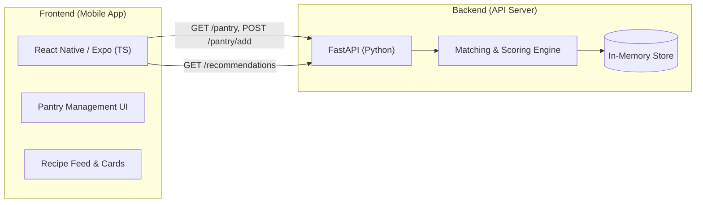
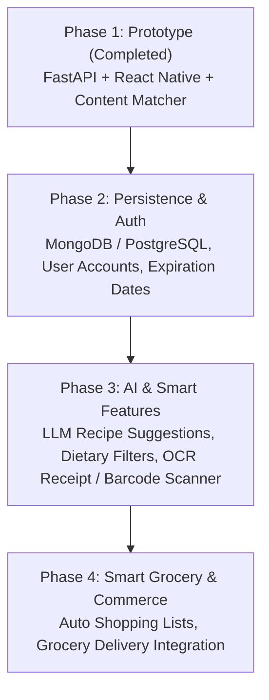

# MealBox360 🥫🍳

> **Smart Pantry Management & Recipe Recommendation System**  
> *Phase 1 Prototype*

MealBox360 helps users eliminate food waste and simplify meal planning by tracking available ingredients in a digital pantry and providing smart, instant recipe recommendations based on what is already available at home.

---

## 📌 Project Scope & Current Implementation (Phase 1)

The project is currently in **Phase 1 Prototype**, establishing the end-to-end client-server architecture, core data flow, and fundamental recommendation engine.

### 1. Implemented Features

- **🥫 Digital Pantry Tracking:**
  - Real-time inventory of household ingredients.
  - Add new ingredients with automatic duplicate prevention and case-normalization.
  - Instant pantry status indicator and item listing.

- **🍳 Content-Based Recipe Recommendation Engine:**
  - Matches pantry ingredients against a catalog of recipes.
  - **Categorization:**
    - 🟢 `Cook Now (100% Match)`: All recipe ingredients are in the pantry.
    - 🟠 `Almost There (Missing X items)`: User is missing 1–2 ingredients.
    - Filters out recipes requiring too many unavailable ingredients.
  - Calculates match percentage ratio (e.g. `2/4`).
  - Identifies and lists missing ingredients for each recipe card.
  - Automatic ranking by best match status.

- **📱 Mobile Client (React Native + Expo):**
  - Cross-platform interface built with React Native and Expo (SDK 58).
  - Clean card-based feed for recommendations with conditional color-coded status badges.
  - Safe area and status bar handling across Android and iOS.
  - Network error diagnostics banner with actionable connection tips.

- **⚡ Backend API (FastAPI):**
  - Lightweight RESTful API built with Python & FastAPI.
  - CORS-configured to allow local Wi-Fi testing on physical mobile devices via Expo Go.

---

## 🏗️ Architecture & Tech Stack



| Layer | Technology | Details |
|---|---|---|
| **Mobile Frontend** | React Native, TypeScript, Expo | Single-page responsive mobile UI, FlatList rendering, typed state |
| **Backend API** | FastAPI, Uvicorn, Python 3.10+ | REST API, Pydantic schemas, CORS middleware |
| **Data Layer (Phase 1)** | In-Memory Data Store | Stored in-process for rapid prototyping |

---

## 🗺️ Roadmap & Future Scope



- **Phase 2 (Persistence & Multi-Tenancy):**
  - Replace in-memory mock store with persistent database (MongoDB / PostgreSQL).
  - User authentication & authorization (JWT, multi-user accounts).
  - Expiration dates and low-stock alerts.
- **Phase 3 (AI & Advanced Nutrition):**
  - Barcode scanning & receipt OCR for fast ingredient logging.
  - Dietary restrictions & allergens (vegan, gluten-free, keto, allergies).
  - Generative AI / LLM integration for creative cooking ideas from leftover ingredients.
- **Phase 4 (Grocery Integration):**
  - One-click grocery shopping list generated from missing recipe ingredients.
  - Export to external shopping/delivery services.

---

## 🚀 How to Run the Project

### Prerequisites

- **Node.js** (v18+) & **npm**
- **Python** (v3.10+)
- **Expo Go** app installed on your physical Android/iOS phone (or an emulator)

---

### Step 1: Start the Backend (FastAPI)

1. Navigate to the `backend` directory:
   ```bash
   cd backend
   ```
2. Activate your virtual environment and install dependencies:
   ```bash
   # If virtual environment doesn't exist yet:
   python3 -m venv .venv

   # Activate environment:
   source .venv/bin/activate    # On Linux/macOS
   # .venv\Scripts\activate     # On Windows

   pip install -r requirements.txt
   ```
3. Start the FastAPI server on port `8001` (binding to `0.0.0.0` allows physical devices on the same Wi-Fi to connect):
   ```bash
   uvicorn main:app --host 0.0.0.0 --port 8001 --reload
   ```
4. Verify the API is running by visiting [http://127.0.0.1:8001/pantry](http://127.0.0.1:8001/pantry) in your browser.

---

### Step 2: Start the Frontend (Expo / React Native)

1. Open a **new terminal** and navigate to the `frontend` directory:
   ```bash
   cd frontend
   ```
2. Install dependencies:
   ```bash
   npm install
   ```
3. Check `API_URL` in `App.tsx`:
   - Open `frontend/App.tsx`.
   - Ensure `API_URL` points to your computer's local Wi-Fi IP and backend port:
     ```ts
     const API_URL = 'http://<YOUR_LOCAL_IP>:8001';
     // Example: 'http://192.168.1.39:8001'
     ```
   > **Tip for Android Emulator:** Use `http://10.0.2.2:8001` instead of your local IP.
4. Launch the Expo development server:
   ```bash
   npx expo start
   ```
5. Open the **Expo Go** app on your phone, scan the QR code displayed in the terminal, and start using MealBox360!
