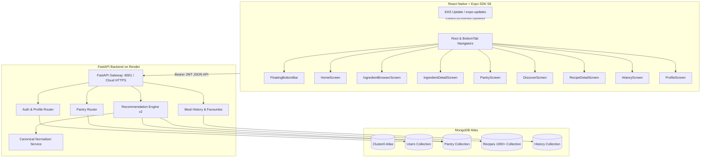

# MealBox360 🥫🍳

> **Personalized Pantry Management & Smart Recipe Recommendation System**  
> *Full-Stack Production Implementation (Expo SDK 58 + React Native + FastAPI + MongoDB Atlas + Render)*

MealBox360 helps users eliminate food waste and simplify meal planning by tracking available ingredients in a digital pantry and providing smart, instant recipe recommendations based on what is already available at home.

---

## 📌 Features & System Capabilities

### 📱 1. Mobile Experience & Design System (Expo SDK 58 + React Native)
* **Warm Organic Visual Identity**:
  - **Forest Green** (`#4A6B3A` / `#3A5530`): Primary actions, headers, and key accents.
  - **Golden Amber** (`#E8C132` / `#F5CE38`): Badges, highlights, and culinary tags.
  - **Warm Off-White & Cream** (`#F0EDE4` / `#FAFAF5`): Soft, eye-pleasing background and card surfaces.
* **Curved Forest Header**: Signature curved bottom arcs (`CurvedHeaderBackground` & `AppHeader`) featuring safe-area insets, back navigation, search slots, and a real-time pantry count badge.
* **White Pill Search Bar**: Rounded search field with leading `🔍` icon, live text filtering, and instant clear (`✕`).
* **Circular Pastel Category Shortcuts**: Quick-filter circular pastel tiles with food icons (🥦 Vegetables, 🍎 Fruits, 🌾 Grains, 🧀 Dairy, 🥚 Protein, 🌶️ Spices).
* **Interactive Quantity Steppers**: Compact plus button (`+`) when count is 0; expands into a golden/forest `[-] [qty] [+]` pill when stocked in pantry.
* **Floating Capsule Navigation**: Elevated pill-shaped bottom bar (`FloatingBottomBar`) floating gracefully above the device safe area.
* **Custom App Icon & Branded Splash**:
  - Master Icon (`1024×1024`): Modern bento meal box crate with fresh organic sprout on rich forest green.
  - Android Adaptive Icon: Properly padded inside the 66% circular mask for Pixel, Samsung, and OnePlus launchers.
  - Branded Splash Screen: Centered MealBox typography and emblem on Forest Green, replacing default wireframe placeholders with zero startup flicker.
* **High-Resolution Recipe Photography**: Integrated Unsplash curated imagery mapping across all dishes and ingredients.
* **Core Screens**:
  - 🏠 **Home Dashboard (`HomeScreen.tsx`)**: Header, search shortcut, category rail, smart cooking tips banner, *"You might need"* ingredient rail with live steppers, and *"Cook Now"* / *"Almost There"* rails.
  - 🥦 **Ingredient Browser (`IngredientBrowserScreen.tsx`)**: 2-column image cards with steppers, category filter tabs (`All`, `Vegetables`, `Fruits`, etc.), and real-time search.
  - 🔍 **Ingredient Details (`IngredientDetailScreen.tsx`)**: Hero food photo, stock status badge, storage tips, related recipes rail, and sticky bottom bar.
  - 🥫 **Digital Pantry (`PantryScreen.tsx`)**: Category filters, item cards with quantity badges and steppers, quick delete confirmation, and custom ingredient modal.
  - 🍳 **Discover Screen (`DiscoverScreen.tsx`)**: Mode switcher (*"Ready to Cook"* vs *"Almost There"*), preparation time limit chips (≤ 15m, ≤ 30m, ≤ 45m), and rich match cards.
  - 📖 **Recipe Detail (`RecipeDetailScreen.tsx`)**: High-res hero imagery, favourite toggle (`❤️`/`🤍`), ingredient availability checklist, step-by-step instructions, and sticky *"Mark as Cooked"* action.
  - 📅 **Meal History (`HistoryScreen.tsx`)**: Cooking milestones summary card (total meals cooked & favourites), chronological meal log, and interactive star ratings.
  - 👤 **Profile & Preferences (`ProfileScreen.tsx`)**: Dietary preference tags (Vegetarian, Vegan, Keto, Halal, etc.), cooking skill selector, and non-medical disclaimer.
  - 🔐 **Auth Screens (`LoginScreen.tsx` & `RegisterScreen.tsx`)**: Forest-curved headers, rounded credential cards, pre-filled demo account hint, and submit actions.

---

### 🥫 2. Digital Pantry Management
- **Full CRUD Operations**: Add, update, view, and delete pantry items.
- **Quantity & Unit Support**: Accurate quantities and units (e.g., `500 g`, `1 cup`, `3 pcs`).
- **Expiry Date Tracking**: Highlights ingredients approaching expiry (`Expiring Soon` within 7 days, `Fresh`, or `Expired`).
- **Canonical Alias Normalization**: Maps synonyms and Indian ingredient names (e.g., `bell pepper` → `capsicum`, `cilantro` / `dhania` → `coriander leaves`, `pyaz` → `onion`).
- **Duplicate Prevention**: Rejects duplicate canonical ingredients for the same user.

---

### 🍳 3. Explainable Recommendation Engine v2
- **Cook Now (100% Match)**: Identifies recipes where every required ingredient is present in the pantry (ignoring optional pantry staples like salt, water, cooking oil).
- **Almost There (Missing 1–2 items)**: Surfaces recipes where the user only needs 1 or 2 missing ingredients.
- **Multi-Factor Weighted Ranking**:
  - **40%** Pantry Coverage
  - **20%** Expiry Urgency Bonus (prioritizes ingredients expiring soon)
  - **15%** Cooking Time Fit
  - **15%** Dietary / Preference Match
  - **10%** Nutrition Signals (when available)
- **Human-Readable Match Reasons**: Explains why a recipe was recommended (e.g., *"Uses all 4 ingredients in your pantry"*, *"Uses spinach that may expire soon"*).
- **Strict Exclusions**: Respects dietary preferences (`vegetarian`, `eggetarian`, `vegan`) and excludes user-configured allergens and disliked ingredients.

---

### 📦 4. Rich Recipe Catalog & Data Quality Pipeline
- **TheMealDB Dataset Integration**: Verified homestyle recipes with complete ingredient measurements, tags, and photography.
- **Curated Indian Homestyle Staples**: Poha, Dal Rice, Vegetable Pulao, Egg Bhurji, Besan Chilla, Curd Rice, Paneer Bhurji, Oats Upma, Masala Dosa, Chole Bhature, and more.
- **Food.com Dataset Support**: Automated cleaner and subset importer filtering recipes and ratings from the Kaggle 1.13M interaction dataset.
- **Over 1,000+ Recipes** indexed in MongoDB Atlas.

---

### 🔐 5. Authentication & Cloud Backend
- **Secure Password Hashing**: Encrypted using modern `bcrypt`.
- **JWT Authorization**: Signed Bearer tokens with configurable expiration.
- **Render.com Cloud Deployment**: Automatic continuous deployment of the FastAPI backend via `render.yaml` (`https://mealbox360.onrender.com`).
- **Dynamic API Client**: Intelligent client in `client.ts` that connects to production Render cloud by default and allows runtime switching to local LAN IPs for offline development.
- **Android Cleartext Traffic Plugin**: Supports local HTTP testing alongside production HTTPS.

---

### ⚡ 6. APK Compression & Over-The-Air (OTA) Updates
- **APK Size Reduction (~90MB → ~25–28MB)**:
  - Custom build plugin (`plugins/withAndroidCompress.js`) isolates target architecture to `arm64-v8a`, eliminating ~65MB of unneeded x86/x86_64/32-bit binaries.
  - Enables Android R8 `fullMode` minification for tighter bytecode packing.
- **Over-The-Air (OTA) Updates (`expo-updates` / EAS Update)**:
  - Supports instant JavaScript & UI updates pushed from CLI without rebuilding or re-distributing `.apk` files on WhatsApp.
  - Updates are pulled seamlessly by user devices upon launching the app.

---

## 🏗️ Architecture & Component Overview



---

## 🚀 Getting Started & Commands

### Prerequisites
- **Node.js** (v18+) & **npm**
- **Python** (v3.10+ / v3.11)
- **EAS CLI**: `npm install -g eas-cli` (for builds and OTA updates)
- **Expo Go** app on physical mobile device (or Android/iOS emulator)

---

### Step 1: Start Backend (FastAPI)

1. Open a terminal in `backend/`:
   ```bash
   cd backend
   source .venv/bin/activate
   ```
2. Configure `backend/.env`:
   ```dotenv
   APP_ENV=development
   JWT_SECRET_KEY=mealbox360-super-secret-jwt-key-change-in-production-abcdef123456
   MONGODB_URI=mongodb+srv://<user>:<password>@cluster0.uxhe1tn.mongodb.net
   MONGODB_DATABASE=mealbox360
   ```
3. Run tests:
   ```bash
   pytest tests/ -v
   ```
4. Start local development server:
   ```bash
   uvicorn main:app --host 0.0.0.0 --port 8001 --reload
   ```
   * Health Check: [http://localhost:8001/health](http://localhost:8001/health)
   * Swagger Docs: [http://localhost:8001/docs](http://localhost:8001/docs)

---

### Step 2: Database Ingestion & Seeding Scripts

Run any of the following from `backend/`:
```bash
# Seed 16 Indian starter recipes, canonical ingredients & demo user:
python scripts/seed_demo_data.py

# Ingest curated TheMealDB catalog with imagery and tags:
python scripts/import_themealdb.py

# Ingest Food.com dataset subset (if RAW_recipes.csv is present in data/raw/):
python scripts/clean_and_import_foodcom.py --limit 1000

# Full database reset and complete re-seed:
python scripts/reset_and_seed_database.py
```

**Pre-Seeded Demo Account Credentials:**
* **Email:** `demo@mealbox360.com`
* **Password:** `demo1234`

---

### Step 3: Run Mobile App Locally (Expo Go)

1. Open a terminal in `frontend/`:
   ```bash
   cd frontend
   ```
2. Configure `frontend/.env`:
   ```dotenv
   # For production Render cloud backend:
   EXPO_PUBLIC_API_URL=https://mealbox360.onrender.com

   # Or for local LAN testing:
   # EXPO_PUBLIC_API_URL=http://<YOUR_LAN_IP>:8001
   ```
3. Start Expo:
   ```bash
   npx expo start
   ```
4. Scan the QR code using the **Expo Go** app on your Android or iOS device.

---

### Step 4: Build Standalone APK (EAS Build)

To build a standalone installable Android APK to distribute via WhatsApp, Drive, or direct download:

```bash
cd frontend

# 1. Build compressed standalone APK (~25MB, arm64-v8a optimized):
eas build -p android --profile preview

# 2. (Optional) Build universal APK (bundles all architectures including x86 emulators):
eas build -p android --profile preview-universal

# 3. (Optional) Build production Android App Bundle (.aab) for Google Play:
eas build -p android --profile production
```

When the build finishes, download the `.apk` file and share it directly on WhatsApp. Recipients simply tap the file and select **Install**.

---

### Step 5: Push Over-The-Air (OTA) Updates (No APK Rebuilding)

When you make changes to React components, styling, or application logic, you **do not** need to rebuild the APK. Publish an OTA update instantly:

```bash
cd frontend

# Push instant update to all preview APK installs:
eas update --branch preview --message "Fixed recipe cards and updated banner"

# Or push update to production channel:
eas update --branch production --message "Production bug fixes"
```

The next time users open the MealBox app, it will automatically download your latest update in the background.

---

## 📡 API Endpoints Reference (`/api/v1`)

| Group | Method | Path | Description |
|---|---|---|---|
| **System** | `GET` | `/health` | Server and database connectivity check |
| **Auth** | `POST` | `/api/v1/auth/register` | Register new account & default preferences |
| **Auth** | `POST` | `/api/v1/auth/login` | Authenticate & obtain Bearer JWT |
| **Auth** | `GET` | `/api/v1/auth/me` | Current user profile |
| **Profile** | `PUT` | `/api/v1/profile` | Update display name |
| **Profile** | `GET` | `/api/v1/preferences` | Retrieve diet, allergies, disliked foods |
| **Profile** | `PUT` | `/api/v1/preferences` | Update dietary preferences |
| **Pantry** | `GET` | `/api/v1/pantry` | List user's pantry items |
| **Pantry** | `POST` | `/api/v1/pantry` | Add pantry item with duplicate prevention |
| **Pantry** | `PATCH` | `/api/v1/pantry/{id}` | Edit quantity, unit, or expiry date |
| **Pantry** | `DELETE` | `/api/v1/pantry/{id}` | Remove pantry item |
| **Pantry** | `GET` | `/api/v1/pantry/expiring` | Query items expiring within X days |
| **Recipes** | `GET` | `/api/v1/recipes/recommendations` | Get Cook Now or Almost There recommendations |
| **Recipes** | `GET` | `/api/v1/recipes/{id}` | Detailed recipe with ingredient availability |
| **Recipes** | `GET` | `/api/v1/recipes/search` | Full-text / regex search recipe catalogue |
| **Recipes** | `POST` | `/api/v1/recipes/{id}/favourite`| Save recipe to user's favourites |
| **Recipes** | `DELETE`| `/api/v1/recipes/{id}/favourite`| Remove from favourites |
| **History** | `POST` | `/api/v1/meals/history` | Mark recipe as cooked |
| **History** | `GET` | `/api/v1/meals/history` | Get paginated meal history |
| **History** | `GET` | `/api/v1/meals/history/summary` | Summary stats of home-cooked meals |
| **Products**| `POST` | `/api/v1/barcode-lookup` | Open Food Facts product barcode search |
| **Nutrition**| `GET` | `/api/v1/nutrition/ingredient`| Cached USDA FoodData Central lookup |

---

## ⚖️ Legal & Medical Disclaimer

> **MealBox360** provides general meal-planning and food-choice assistance for lifestyle convenience. It is not medical advice and is not intended to diagnose, treat, cure, or prevent any disease. Nutrition and allergen data may be estimated; always verify packaged product labels and consult a healthcare professional for specific medical dietary requirements.

### Attribution
- **TheMealDB**: Open recipe database for community food data and photography.
- **Food.com Recipes and Interactions**: Shuyang Li et al. (Used for academic research under dataset terms).
- **Open Food Facts**: Open Food Facts database under Open Database License (ODbL).
- **USDA FoodData Central**: U.S. Department of Agriculture, Agricultural Research Service.
