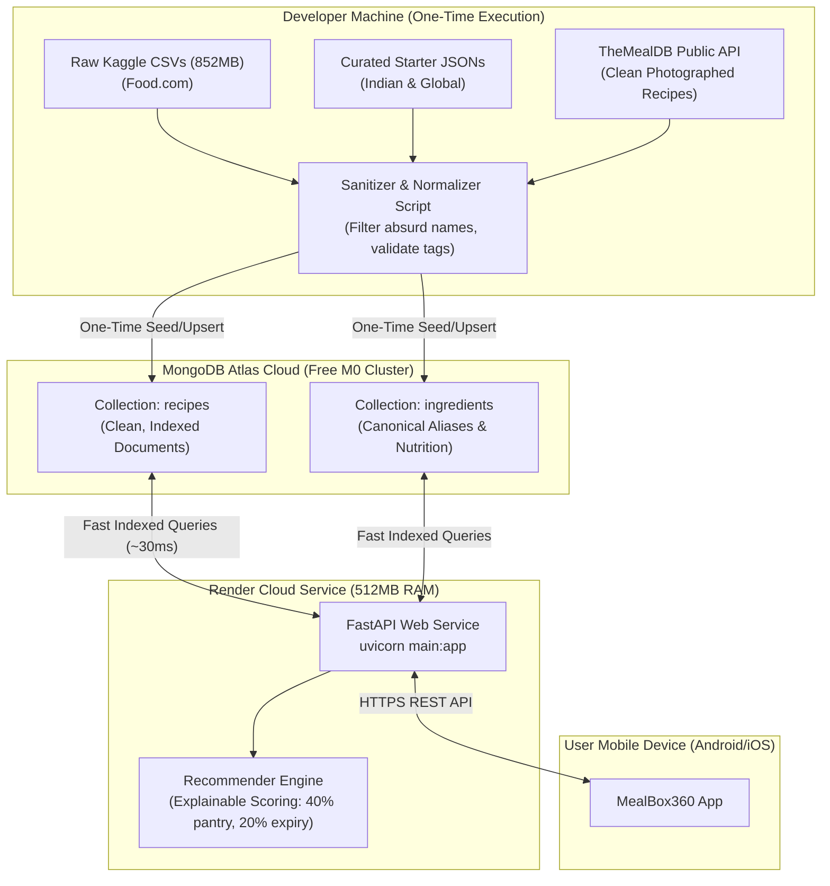

# Data Architecture, Recipe Quality & Recommender Pipeline Plan

## Goal Description
MealBox360 requires a clean, robust data pipeline that:
1. Explains how the deployed Render backend retrieves recipe data without loading 852MB of raw CSV files into its 512MB RAM environment.
2. Clarifies the role of Machine Learning vs. the current deterministic explainable scoring engine.
3. Evaluates storage options (MongoDB Atlas cloud vs. GitHub Releases vs. local disk).
4. Solves the problem of "absurd/false recipe names" inherited from raw user-submitted datasets (e.g. Food.com) by introducing a sanitization and curation pipeline with verified open APIs (TheMealDB) and clean seed data.

---

## User Review Required

> [!IMPORTANT]
> **Render Does NOT and SHOULD NOT Load the 852MB Raw CSV Files!**
> Render's free tier has **512 MB of RAM**. Loading `RAW_recipes.csv` (281MB) and `RAW_interactions.csv` (334MB) in pandas requires **~2.5 GB of RAM**, which will instantly crash Render with an Out-Of-Memory (OOM) error.
> 
> **The Right Architecture:**
> - Data lives permanently in **MongoDB Atlas** in the cloud.
> - The data is populated into MongoDB Atlas **once** (by running a seeding script from your computer).
> - Render only runs FastAPI, which queries MongoDB Atlas via indexed database calls using less than 100MB of RAM.

> [!NOTE]
> **No Machine Learning Model is Trained (and Why That is a Good Thing):**
> MealBox360 currently uses a **deterministic, explainable content-based recommendation engine** ([recommender.py](file:///home/abdullah/Documents/Projects/MealBox/backend/app/services/recommender.py)).
> - It calculates exact pantry coverage (e.g. 4/4 ingredients = 100%), adds expiry urgency bonuses for ingredients expiring within 7 days, checks dietary restrictions, and separates recipes into **Cook Now** vs. **Almost There** (missing 1-2 items).
> - This requires 0MB of model weights, never hallucinates recipes, runs in <5 milliseconds, and provides clear explanations to users (e.g., *"Uses your spinach expiring in 2 days"*).

---

## Data Flow Architecture



---

## Analysis: Why Absurd / False Names Exist & 4 Remediation Options

### Why are there absurd names?
The Kaggle Food.com dataset consists of over 230,000 recipes submitted by random forum users between 2000 and 2018. It contains:
- Joke / vanity titles: *"kittencal s best ever...", "my ex husband s favorite...", "green slime dip"*
- Missing / bizarre ingredients: *"1 can mystery meat", "magic seasoning"*
- Outlier cooking times: `0 minutes` or `2147483647 minutes`
- Low-effort or unvetted user submissions.

### The 4 Remediation Possibilities

| Option | Approach | Pros | Cons | Feasibility / Rating |
| :--- | :--- | :--- | :--- | :--- |
| **Option 1: Clean Food.com with RegEx & Quality Heuristics** | Write a sanitizer script that filters out author prefixes (`'s`), filters ratings $\ge 4.0$, rating count $\ge 3$, removes weird time/step outliers. | Keeps a sizable recipe catalog (~3,000–5,000 recipes) without paying for data. | Food.com recipes lack photos; some odd descriptions slip through. | ⭐⭐⭐ (Good for bulk data) |
| **Option 2: Import from TheMealDB API** | Write a script to fetch TheMealDB's ~300 verified international and Indian recipes. | Every single recipe has a high-res photo, video link, clean title, standard ingredients, and verified cooking steps. | Dataset is ~300 recipes rather than thousands. | ⭐⭐⭐⭐⭐ (Highest Quality) |
| **Option 3: Curate Expanded Starter JSONs** | Expand `indian_starter_recipes.json` to ~50–100 everyday staples (North Indian, South Indian, Continental, Quick Breakfasts, Salads). | 100% curated, zero noise, high nutritional accuracy, matches common Indian and global pantries. | Requires manual curation or verified recipe scraping. | ⭐⭐⭐⭐ (Best for localized accuracy) |
| **Option 4: Train an ML / LLM Recipe Generator** | Fine-tune a model to generate recipes from ingredients. | Infinite recipe variations. | High latency (2-5s), needs GPU or paid OpenAI API tokens, high risk of hallucinating toxic or uncookable ingredient combos. | ⭐ (Not recommended for student/free tier) |

---

## Recommended Best Path (The 3-Pillar Solution)

We propose a **hybrid strategy** that gives you clean names, zero server crashes, and verified food photos:

1. **Pillar 1: TheMealDB Importer Script (`scripts/import_themealdb.py`)**
   - Automatically fetches verified recipes from TheMealDB API (using free test key `1`).
   - Normalizes ingredients into our canonical ingredient catalogue.
   - Provides actual high-resolution dish images so the app looks stunning.
2. **Pillar 2: Food.com Data Sanitizer (`scripts/clean_and_import_foodcom.py`)**
   - Strips author names (`"kittencal s"`, `"mama s"`, `"my famous"`).
   - Strict blacklist filter for absurd keywords (`"gross"`, `"slime"`, `"mystery"`, etc.).
   - Discards recipes without ratings, recipes with average rating $< 4.0$, or recipes with $< 3$ reviews.
   - Enforces time constraints: $10 \le \text{total minutes} \le 120$.
3. **Pillar 3: Expanded Seed Data (`indian_starter_recipes.json`)**
   - Expands the current 16 starter recipes to 40 popular household dishes with exact ingredient breakdowns.
   - Seeded directly into MongoDB Atlas with a single command.

---

## Proposed Changes

### Component 1: Data Importers & Sanitizers

#### [NEW] `backend/scripts/import_themealdb.py`
A script that queries TheMealDB across common categories (Chicken, Vegetarian, Pasta, Seafood, Breakfast, Dessert, Indian), extracts standard ingredients, cleans instructions, attaches high-resolution photography, and upserts them directly into MongoDB Atlas.

#### [NEW] `backend/scripts/clean_and_import_foodcom.py`
An enhanced, filtered version of the Food.com importer:
- Regex cleaner:
  ```python
  def clean_recipe_title(raw_title: str) -> Optional[str]:
      # Remove possessives and author tags like "Jane's Amazing..." -> "Amazing..."
      # Remove parenthetical notes e.g. "(Quick!)", "(Delicious!)"
      # Discard if title contains absurd words or symbols
  ```
- Strict quality gates:
  - Average rating $\ge 4.2$ with $\ge 5$ user reviews.
  - Number of ingredients between 4 and 10.
  - Steps $\ge 3$.
  - Cooking time between 15 and 90 minutes.

#### [MODIFY] `backend/data/seeds/indian_starter_recipes.json`
Add 25 additional clean, verified household recipes (e.g. Rajma Chawal, Paneer Tikka, Masala Dosa, Chana Masala, Vegetable Biryani, Butter Chicken, Tomato Soup, Masala Omelette, Upma) with canonical ingredients and images.

---

### Component 2: Execution Strategy for Render

How Render accesses the data:
1. You run the import/seed script **once** from your computer:
   ```bash
   cd backend && source .venv/bin/activate
   python scripts/seed_demo_data.py
   python scripts/import_themealdb.py
   ```
2. The recipes and ingredients are stored securely in **MongoDB Atlas** (`mealbox360.recipes` and `mealbox360.ingredients`).
3. Render is already configured with `MONGODB_URI` in its environment variables.
4. When Render starts:
   - It connects to MongoDB Atlas in ~0.5 seconds.
   - Memory consumption remains low (~80MB).
   - Every time a user opens the app, FastAPI queries MongoDB Atlas for clean recipes.
5. **No raw CSV files or GitHub Releases need to be downloaded by Render.**

---

## Verification Plan

### Automated Verification
1. Run backend tests to ensure the recommender functions with newly seeded recipes:
   ```bash
   cd backend && source .venv/bin/activate
   pytest tests/test_recommendations.py tests/test_normalizer.py
   ```
2. Verify recipe title sanitizer with unit tests:
   - Ensure clean title strings pass.
   - Ensure absurd/vanity titles are properly filtered out or cleaned.

### Manual Verification
1. Run `scripts/import_themealdb.py` and inspect sample records in MongoDB Atlas to verify:
   - Valid, appetizing titles.
   - Real, working high-resolution images (`image_url`).
   - Clean canonical ingredient mappings.
2. In the mobile app:
   - Open **Discover** tab and check recipe cards for clear titles and appetizing photos.
   - Add ingredients to the pantry and verify **Cook Now** and **Almost There** recommendations calculate properly.
